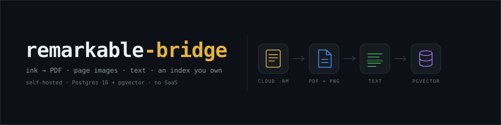
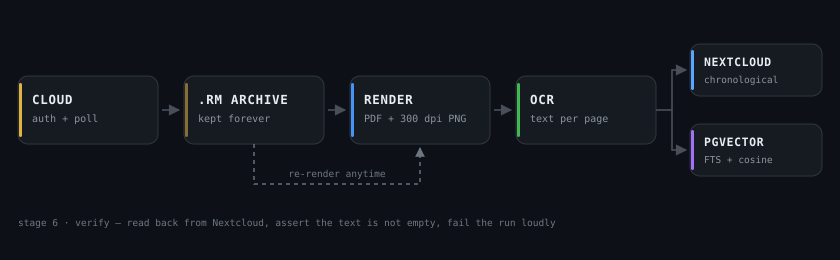

<div align="center">



<h3>Your reMarkable notebooks, out of the drawer and into your own cloud —<br>
as PDF, as searchable text, as page images, and as an index you actually own.</h3>

<p>
  <a href="LICENSE"></a>
  
  
  
  
  <a href="#contributing"></a>
</p>

<p>
  <a href="#the-problem">Problem</a> ·
  <a href="#how-it-works">How it works</a> ·
  <a href="#quickstart">Quickstart</a> ·
  <a href="#status">Status</a> ·
  <a href="#roadmap">Roadmap</a> ·
  <a href="docs/design.md">Design doc</a>
</p>

</div>

> [!WARNING]
> **v0.1 — pre-alpha.** The database layer is written, deployed and tested; the ingest → render →
> publish pipeline is not finished. Nothing below claims otherwise: every ✅ in the status table was
> executed, and everything else is labelled 🚧. If you want a finished tool today, this is not it yet.

---

## The problem

Handwriting is the most natural way to think, and the worst format to keep.

A reMarkable is a brilliant writing surface and a terrible archive. Notes live on a device with a
finite disk, an export flow designed for one notebook at a time, and no search worth the name.
Cloud sync gets your files somewhere — usually into a vendor's app, as opaque notebooks — and stops
exactly where the useful part begins: *"What did I decide about the kitchen budget in September?"*

There are a dozen "export your reMarkable to X" scripts. Almost all of them share the same three
faults: they key on filenames (so a rename duplicates your data), they dump a flat pile of PDFs
(so nothing is chronological except by luck), and they stop before text (so the archive is
unsearchable and the whole exercise is a slightly tidier drawer).

**remarkable-bridge** is the pipeline that does the boring, correct thing end to end: pull from the
cloud API, render ink to real vector PDFs, recognise the handwriting, file it chronologically into
your Nextcloud, and index it into a plain Postgres with hybrid full-text + vector search — so an
agent, or `psql`, can answer questions about it in milliseconds.

## How it works



Six stages, each one independently re-runnable: **auth & poll → render → OCR → publish → index →
verify**. The raw ink archive is the load-bearing decision — everything after it can be rebuilt
without touching the tablet again.

## Why not just export to PDF?

| Aspect | Typical export script | remarkable-bridge |
|---|---|---|
| Identity | filename (rename ⇒ duplicate) | device document UUID, `UNIQUE` in the schema |
| Order | whatever `ls` gives you | `YYYY-MM-DD_HHMM_<title>` inside `/<year>/<year-month>/` |
| Output | PDF only | PDF + 300 dpi page PNGs + Markdown with front matter |
| Text | ✗ | per-page transcription, `[[KEIN_TEXT]]` for sketches |
| Search | ✗ (grep your own files) | German FTS + vector similarity, fused, page-level citations |
| Re-processing | re-export from the device | re-render from the archived `.rm` files |
| Ownership | vendor app or a flat folder | Postgres you can `pg_dump`, files you can `rsync` |

<sub>The middle column describes the common pattern in the export scripts that circulate for
reMarkable — not a claim about every tool. If one of them already does all of this, use that one.</sub>

## What makes it different

**Identity is the document UUID, never the filename.**
Rename a notebook on the tablet a hundred times; the pipeline updates one row instead of creating a
hundred documents. `remarkable_id` is unique in the schema, and every upsert keys on it.

**Chronological by construction, not by convention.**
Files land as `YYYY-MM-DD_HHMM_<title>.pdf` inside `/<year>/<year-month>/`. That sorts correctly in
Nextcloud, in Finder, in `ls`, in any WebDAV client and on your phone — without a database telling
the file browser what order to use. The date comes from the notebook's own creation metadata, and
when it has to fall back (`cloud lastModified` → `filename`) the fallback is recorded in
`captured_date_source`, so you can see which files you can trust.

**Hybrid retrieval in one SQL function.**
German full-text ranking (`to_tsvector('german', …)`, GIN-indexed) fused 50/50 with pgvector cosine
similarity (HNSW-indexed). One call, page-level results, no separate vector database to run:

```sql
SELECT visible_name, page_no, score, snippet
FROM remarkable.search('Schreiner Angebot', NULL, 5);   -- keyword
-- or pass an embedding for semantic search, or both for hybrid
```

**It fails loudly instead of silently.**
The most dangerous outcome in a pipeline like this is a document that publishes fine and contains
zero text. So text length is asserted after publish, the stage exits non-zero, and `v_attention`
lists every notebook with failed OCR or empty pages. A silent empty index is a bug; a loud one is a
Monday.

**The raw ink is never thrown away.**
`.rm` files are archived per notebook. OCR quality will improve, models will change, and when it
does you re-render the archive instead of re-exporting from the tablet.

**Self-hosted end to end.**
No proprietary index, no SaaS middleman: Postgres you can `pg_dump`, files you can `rsync`, and
Nextcloud as the human-facing surface. The retrieval layer is a schema any tool can query.

## Status

| Piece | Status | Evidence |
|---|---|---|
| Postgres 16 + pgvector schema (`core`, `remarkable`) | ✅ done | tables, views, HNSW + GIN indexes created |
| Hybrid search `remarkable.search(q, q_emb, k)` | ✅ done | FTS hit, vector hit, and fused hit verified on injected rows |
| Pipeline DB role with scoped grants | ✅ done | smoke test executed **as** the unprivileged role, then rolled back |
| Vision OCR through the local ollama HTTP API | ✅ done | 1 page → **6.4 s**, 1,941 chars, German, table layout preserved |
| reMarkable cloud ingest (rmapi) | 🚧 next | auth needs a one-time code from the device owner |
| `.rm` → PDF/PNG rendering (rmc + pdftoppm) | 🚧 planned | |
| Nextcloud publish (chronological tree, idempotent) | 🚧 planned | |
| Handwriting accuracy benchmark | 🚧 planned | the 6.4 s result above is printed text — plumbing, not accuracy |

> [!NOTE]
> **On OCR engines.** Tesseract is fine on printed pages and poor on handwriting (benchmarks put a
> 15–22 % critical-error rate on handwritten notes). Vision LLMs do markedly better on ink, and a
> local `ollama` endpoint keeps the plumbing identical whether the model runs beside you or in the
> cloud. The project ships a harness (`spikes/vision_ocr.py`) so accuracy is *measured on your
> handwriting* before it is trusted — not assumed from someone's blog post.

## Quickstart

The database layer is the part that works today. Bring it up and prove the schema to yourself in
about two minutes.

**Requirements:** Docker with Compose and ~500 MB of disk. No local Postgres — `psql` runs inside
the container.

```bash
git clone https://github.com/TheCabbageBaggage/remarkable-bridge
cd remarkable-bridge/db
```

```bash
# 1. secrets, never committed
printf 'POSTGRES_PASSWORD=%s\n' "$(openssl rand -hex 24)" > .env && chmod 600 .env
printf '%s\n' "$(openssl rand -hex 24)" > .pgpass && chmod 600 .pgpass

# 2. start Postgres 16 + pgvector, loopback only
docker compose up -d && docker compose ps

# 3. structural check
docker exec -i remarkable-db psql -U remarkable -d remarkable -f /dev/stdin < verify.sql

# 4. give the pipeline role its password, then run the smoke test as that role
PW=$(cat .pgpass)
docker exec -i remarkable-db psql -U remarkable -d remarkable -c "ALTER ROLE rmbridge PASSWORD '$PW';"
docker exec -i remarkable-db psql -U rmbridge -d remarkable -f /dev/stdin < smoke_test.sql
```

Expect, in this order: a full-text hit on page 2, an embedding-only hit on page 1, a hybrid result
with a fused score, German stemming confirmed — then `ROLLBACK`, leaving zero rows behind.

Try the OCR harness against any page image:

```bash
python3 spikes/vision_ocr.py page-1.png --model <vision-model>   # ollama on 127.0.0.1:11434
```

> [!TIP]
> Pitfall baked into the harness: thinking models spend the entire `num_predict` budget on
> reasoning tokens and return an empty string (`done_reason: length`). The harness sends
> `"think": false` and a 4096-token budget.

## Repository layout

<details>
<summary><b>Files and what each one is for</b></summary>

```
db/
  docker-compose.yml      Postgres 16 + pgvector, 127.0.0.1 only, named volume
  init/001_core.sql       schema-per-domain foundation: source registry, run log
  init/002_remarkable.sql notebooks, pages, chunks, hybrid search, views, role grants
  verify.sql              read-only structural check
  smoke_test.sql          write + search + rollback, run as the pipeline role
spikes/
  vision_ocr.py           dependency-free ollama vision OCR harness (timing + quality)
docs/
  design.md               full design: stages, data model, risks, decisions, estimates
  assets/banner.svg       this README's header
  assets/pipeline.svg     the pipeline diagram above
pipeline/                 the ingest → render → publish → index pipeline (in progress)
```

</details>

## Data model in one glance

<details>
<summary><b>Schema, indexes and the retrieval function</b></summary>

```
core.source        which systems feed this database (extensible by design)
core.ingest_run    every pipeline run, stage, status, error

remarkable.notebook   identity + chronology
                      remarkable_id (unique, = device UUID), visible_name, captured_at,
                      captured_date_source, cloud_modified_at, page_count, pdf_sha256,
                      nc_pdf_path, nc_md_path, ocr_engine, ocr_model, ocr_confidence, status
remarkable.page       (notebook_id, page_no) → image_path, text, text_len, ocr_confidence, layer_count
remarkable.chunk      text, tsv (generated, german), embedding vector(1024), HNSW + GIN indexed
```

Two views do the operational reading: `v_timeline` (what arrived when) and `v_attention` (what
failed, what is empty, what OCR never produced text for).

Embedding width is fixed at 1024 to match `mxbai-embed-large`; change the dimension in one place if
you prefer another model.

</details>

## Compatibility

- **reMarkable 2**, `.rm` v6 page format. Paper Pro support depends on `rmc`; the raw-ink archive
  means a later renderer can be swapped in without re-exporting anything.
- Cloud access uses the community-maintained [`rmapi`](https://github.com/ddvk/rmapi) fork
  (unofficial API — pin the version). Without a Connect subscription, files untouched for ~50 days
  stop syncing; that ceiling is documented rather than worked around.
- Postgres 16 + `pgvector` ≥ 0.8 for HNSW indexes.

## Roadmap

- [x] Central Postgres schema with per-domain schemas and scoped roles
- [x] Hybrid German FTS + pgvector retrieval, page-level citations
- [x] Vision-OCR harness with timing and thinking-token handling
- [ ] `rmapi` auth (one-time code) + change detection on `document_id`
- [ ] `.rm` v6 → vector PDF + 300 dpi PNGs, all layers merged
- [ ] Per-page OCR, Markdown with YAML front matter
- [ ] Idempotent Nextcloud publish, chronological tree, read-back verification
- [ ] Embeddings written per chunk, `search()` smoke test on real notes
- [ ] Handwriting accuracy benchmark across engines (this decides the default model)
- [ ] systemd timer, lockfile, alerting, 12-month backfill

## Contributing

Early days: the fastest way to help is a **reMarkable 2 page image plus its correct transcription**,
which goes straight into the accuracy benchmark. For code, open an issue before a pull request —
the schema is stable, the pipeline is not.

<details>
<summary><b>Coding conventions</b></summary>

- Every stage must be re-runnable and idempotent; a second run over the same notebook writes no
  duplicates.
- Anything that can silently produce empty text fails loudly (non-zero exit, row in `v_attention`).
- No private infrastructure in code or docs — configuration via environment, never hard-coded hosts.
- SQL stays in `db/init/` as plain, readable migration files; no ORM.

</details>

## Acknowledgements

Standing on other people's work: [`rmapi`](https://github.com/ddvk/rmapi) for the cloud API,
[`rmc`](https://github.com/ricklupton/rmc) and `pdftoppm` for rendering, `pgvector` for making
Postgres a vector store, `ollama` for keeping the OCR model local, and Nextcloud for being a
human-usable archive.

## License

MIT — see [LICENSE](LICENSE).

---

<div align="center">
<sub>Built for a self-hosted setup where the notebook, the OCR model, the files and the index all
belong to the same person. If you have a reMarkable, a Nextcloud and a spare container, you are the
target audience.</sub>
</div>
